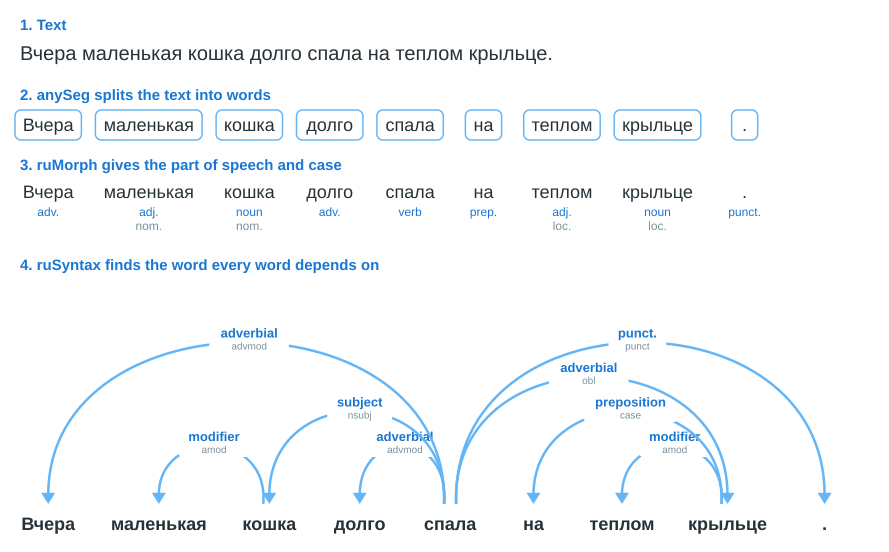

# ruSyntax


**ruSyntax** is a dependency parser of Russian: a Rust core with a Python API. For every word of a sentence the parser finds its head and the relation between them in the [Universal Dependencies](https://universaldependencies.org/) annotation. The [anySeg](https://github.com/SergeyShk/anySeg) segmenter splits the text into sentences and words, the [ruMorph](https://github.com/SergeyShk/ruMorph) morphological analyzer gives the parts of speech and features.

!!! warning "Work in progress"
    The API may change until version 0.1.0. Versions `0.1.0.devN` are published on TestPyPI.

=== "Code"

    ``` python
    from rusyntax import Parser

    parser = Parser()
    document = parser.parse_text("Мама мыла раму.")
    [(word.form, word.head, word.deprel) for word in document.words]
    ```

=== "Result"

    ```
    [('Мама', 2, 'nsubj'), ('мыла', 0, 'root'), ('раму', 2, 'obj'), ('.', 2, 'punct')]
    ```

## How it works { #how }

A sentence goes through three steps: the anySeg segmenter splits the text into words, the ruMorph morphological analyzer gives every word its part of speech and features - case, number, gender - and ruSyntax uses the words and their features to find which word every word depends on and how: the subject depends on the predicate, a modifier on the word it modifies, a preposition on the word it belongs to.



The methods of the parser are on the [Parser](parser.md) page, the architecture and training of the model on the [Model](model.md) page, quality and speed compared with other parsers on the [Comparison](performance.md) page.

## Installation

Python 3.11 or newer is required.

``` bash
pip install rusyntax
```

Prebuilt wheels and building from source are described on the [Installation](installation.md) page.
