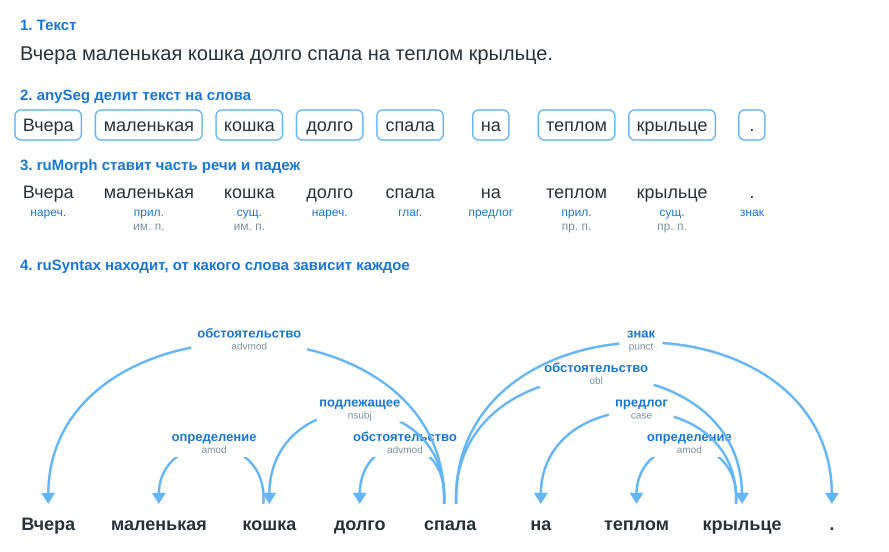

# ruSyntax


**ruSyntax** - синтаксический анализатор русского языка: ядро на Rust и API для Python. Для каждого слова предложения анализатор находит вершину и тип синтаксической связи в разметке [Universal Dependencies](https://universaldependencies.org/). Текст делит на предложения и слова сегментатор [anySeg](https://github.com/SergeyShk/anySeg), части речи и признаки ставит морфологический анализатор [ruMorph](https://github.com/SergeyShk/ruMorph).

=== "Код"

    ``` python
    from rusyntax import Parser

    parser = Parser()
    document = parser.parse_text("Мама мыла раму.")
    [(word.form, word.head, word.deprel) for word in document.words]
    ```

=== "Результат"

    ```
    [('Мама', 2, 'nsubj'), ('мыла', 0, 'root'), ('раму', 2, 'obj'), ('.', 2, 'punct')]
    ```

## Как это работает { #how }

Предложение проходит три шага: сегментатор anySeg делит текст на слова, морфологический анализатор ruMorph ставит каждому слову часть речи и признаки - падеж, число, род, - а ruSyntax по словам и их признакам находит, от какого слова зависит каждое и как: подлежащее зависит от сказуемого, определение - от определяемого слова, предлог - от слова, к которому он относится.



Методы анализатора описаны на странице [Анализатор](parser.md), устройство и обучение модели - на странице [Модель](model.md), качество и скорость в сравнении с другими анализаторами - на странице [Сравнение](performance.md). Файлы и потоки разбирает в CoNLL-U [команда rusyntax](cli.md).

## Установка

Требуется Python 3.11 или новее.

``` bash
pip install rusyntax
```

Готовые колеса и сборка из исходников описаны на странице [Установка](installation.md).
