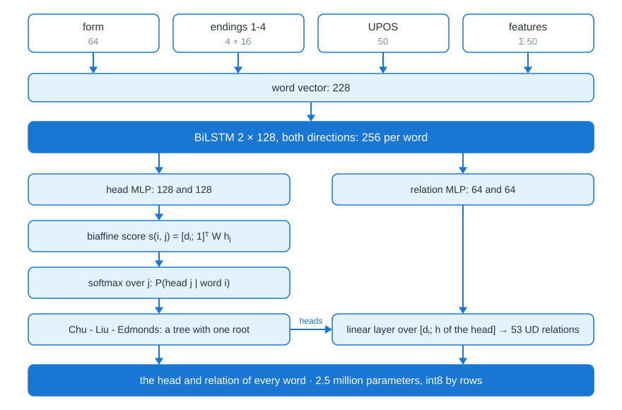
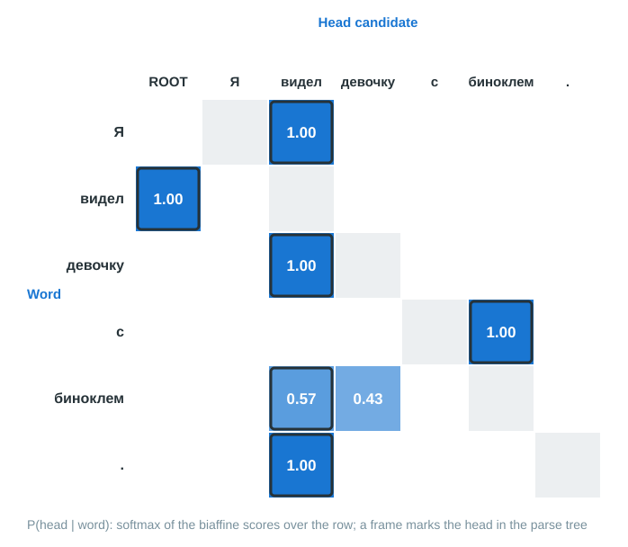

# Model

The package model is built into the extension module: no weights file is needed, and `Parser()` loads it in 10 ms. Quality and speed compared with other parsers are on the [Comparison](performance.md) page.

## Architecture { #architecture }

- **Word input** - the form (the 20 thousand most frequent forms of the training data; lowercase, «ё» as «е»; other forms are unknown), the endings of 1 to 4 letters with a word-start mark, and the UD part of speech and features from ruMorph.
- **Encoder** - a bidirectional LSTM, two layers of 128 per direction: every word sees the whole sentence.
- **Heads** - a biaffine score of every pair «word - head candidate» and the tree with the highest sum of scores and one root (the Chu - Liu - Edmonds algorithm), so non-projective trees are possible too.
- **Relations** - a linear score of the pair «dependent - head» over 53 UD relations with subtypes.
- **Weights** - 2.5 million parameters, matrices in int8 by rows with a scale per row; the file is 3.4 MB with the vocabularies of forms and endings. Quantization does not change the quality: on dev the difference from float32 weights is at most 0.04 LAS.

The part of speech and features come from the morphological analyzer, so the model is small and fast: with the ruMorph tags a two-layer LSTM of 128 parses almost as accurately as a three-layer LSTM of 400 without tags, with ten times less computation.

## Choosing the head { #heads }

For every word the model scores every word of the sentence and the root as a head candidate - the biaffine score `s(i, j)` - and turns the scores of the row into probabilities. In «Я видел девочку с биноклем» («I saw the girl with binoculars») the word «биноклем» has two plausible candidates: «видел» (the binoculars are the instrument, 0.54) and «девочку» (the girl has the binoculars, 0.46); for the other words the choice is clear. The tree is built from these choices: if the best heads already form a tree with one root, it is taken, otherwise the Chu - Liu - Edmonds algorithm finds the tree with the highest sum of log probabilities. The numbers in the picture come from the forward pass of the package model (`scripts/figures.py`).

## Training { #training }

The model is trained on the training parts of the treebanks [UD_Russian-Taiga](https://github.com/UniversalDependencies/UD_Russian-Taiga), [UD_Russian-GSD](https://github.com/UniversalDependencies/UD_Russian-GSD) and [UD_Russian-Poetry](https://github.com/UniversalDependencies/UD_Russian-Poetry) of the UD 2.19 release - 1.85 million words of blogs, social media, reviews, Wikipedia, educational and popular science texts, children's literature, news and poetry. [UD_Russian-SynTagRus](https://github.com/UniversalDependencies/UD_Russian-SynTagRus) is distributed under the CC BY-NC-SA 4.0 license, which forbids commercial use, and is not part of the training: the model is only tested on it. The parts of speech and features of the training words are given by ruMorph in context - so the model learns on the tags of the same analyzer the user has, not on the gold ones. On the training parts the ruMorph tags are more accurate than on new text: Taiga and GSD are part of its training. The training point is chosen by the mean LAS of the development parts of Taiga and GSD.

`make model` reproduces the training: `scripts/export_ud.py` downloads the treebanks and checks their SHA-256, `scripts/train.py` with pinned package versions (`scripts/train.py.lock`) trains the model - about half an hour on an Apple M3 Pro (MPS) - and writes the weights to `data/ru-syntax.bin`. On MPS and GPU training is non-deterministic: a rerun gives close but not the same weights. Together with the weights it writes `data/check.conllu` - the parse of 300 sentences by the same model in PyTorch: a test of the crate checks the Rust forward pass against it.

## Custom model { #custom }

`Parser(path)` loads a model from a file of the ruSyntax format - for example, one trained by `scripts/train.py` on other data. The file is checked on loading: the signature, the format version, the checksum and the sizes of all weights. How the model was trained is in `parser.sources`, its relations in `parser.relations`.

## License { #license }

The model is trained on data under the CC BY-SA 4.0 license and is distributed under it too ([LICENSE-MODEL.txt](https://github.com/SergeyShk/ruSyntax/blob/master/LICENSE-MODEL.txt)); the ruSyntax code is under the MIT license.
