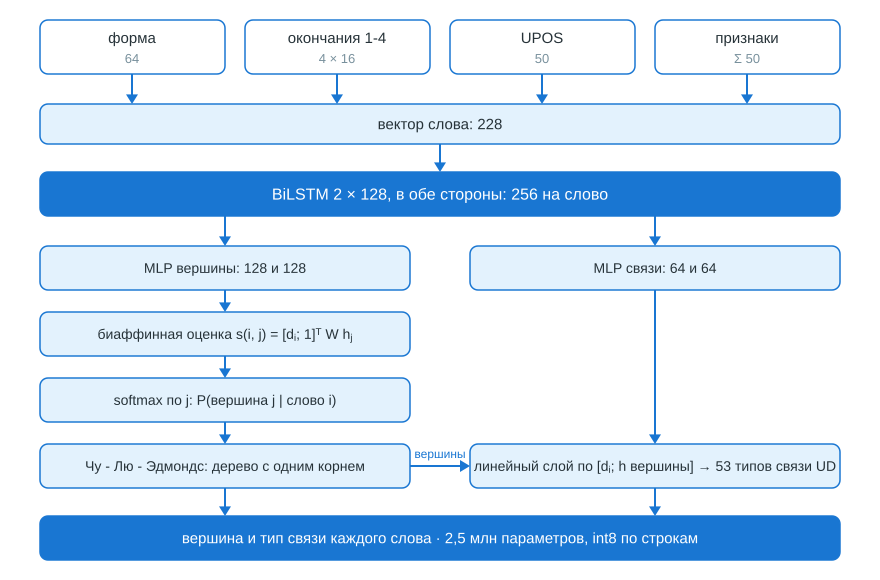
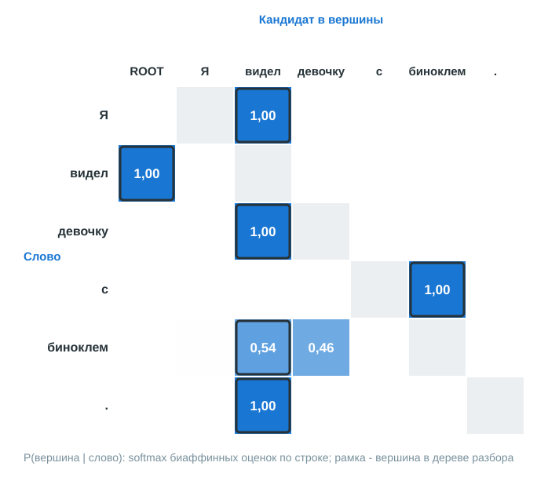

# Модель

Модель пакета вшита в модуль расширения: файл весов не нужен, анализатор `Parser()` загружает ее за 10 мс. Качество и скорость в сравнении с другими анализаторами - на странице [Сравнение](performance.md).

## Устройство { #architecture }

- **Вход слова** - форма (20 тыс. самых частых форм обучающих данных; строчные буквы, «ё» как «е»; остальные формы - неизвестные), окончания длиной от 1 до 4 букв с меткой начала слова, часть речи и признаки UD от ruMorph.
- **Кодировщик** - двунаправленный LSTM, два слоя по 128 на направление: каждое слово видит все предложение.
- **Вершины** - биаффинная оценка каждой пары «слово - кандидат в вершину» и дерево с наибольшей суммой оценок и одним корнем (алгоритм Чу - Лю - Эдмондса), поэтому непроективные деревья тоже возможны.
- **Связи** - линейная оценка пары «зависимое - вершина» по 53 типам связи UD с подтипами.
- **Веса** - 2,5 млн параметров, матрицы в int8 по строкам с множителем на строку; файл - 3,4 МБ вместе со словарями форм и окончаний. Квантование не меняет качество: на dev разница с весами float32 - не больше 0,04 LAS.

Часть речи и признаки дает морфологический анализатор, поэтому модель маленькая и быстрая: с тегами ruMorph двухслойный LSTM по 128 разбирает почти так же точно, как трехслойный по 400 без тегов, при вдесятеро меньшем счете.

## Выбор вершины { #heads }

Для каждого слова модель оценивает каждое слово предложения и корень как кандидата в вершины - биаффинная оценка `s(i, j)` - и превращает оценки строки в вероятности. В предложении «Я видел девочку с биноклем» у слова «биноклем» два правдоподобных кандидата: «видел» (бинокль - инструмент, 0,57) и «девочку» (бинокль у девочки, 0,43); у остальных слов выбор однозначен. Дерево собирается из таких выборов: если лучшие вершины уже дают дерево с одним корнем, оно и берется, иначе алгоритм Чу - Лю - Эдмондса находит дерево с наибольшей суммой логарифмов вероятностей. Числа на картинке - прямой проход модели пакета (`scripts/figures.py`).

## Обучение { #training }

Модель обучена на обучающих частях трибанков [UD_Russian-Taiga](https://github.com/UniversalDependencies/UD_Russian-Taiga), [UD_Russian-GSD](https://github.com/UniversalDependencies/UD_Russian-GSD) и [UD_Russian-Poetry](https://github.com/UniversalDependencies/UD_Russian-Poetry) релиза UD 2.19 - 1,85 млн слов блогов, соцсетей, отзывов, Википедии, учебных и научно-популярных текстов, детской литературы, новостей и стихов. [UD_Russian-SynTagRus](https://github.com/UniversalDependencies/UD_Russian-SynTagRus) распространяется по лицензии CC BY-NC-SA 4.0, запрещающей коммерческое использование, и в обучение не входит: на нем модель только проверяется. Части речи и признаки слов обучающих данных ставит ruMorph 0.7 с контекстом - так модель учится на тегах того же анализатора, что у пользователя, а не на эталонных. Обучающие части Taiga, GSD и Poetry входят и в обучение ruMorph, и на Taiga и Poetry его теги там заметно точнее, чем на новом тексте: часть речи и признаки вместе верны у 93,8 % слов train Taiga против 90,1 % dev (у GSD разрыв мал). Поэтому у неоднозначного слова train Taiga и Poetry с вероятностью 9 % и 4 % берется следующий разбор ruMorph с другими тегами: точность тегов train становится как на dev. LAS dev от этого в среднем по пяти запускам выше на 0,09 на эталонных токенах и на 0,14 на сыром тексте - меньше разброса между запусками. Точка обучения выбирается по среднему LAS проверочных частей Taiga и GSD.

Обучение воспроизводит `make model`: `scripts/export_ud.py` скачивает трибанки с проверкой SHA-256, `scripts/train.py` с закрепленными версиями пакетов (`scripts/train.py.lock`) учит модель - около получаса на Apple M3 Pro (MPS) - и пишет веса в `data/ru-syntax.bin`. На MPS и GPU обучение недетерминировано: повторный запуск дает близкие, но не те же веса. Вместе с весами пишется `data/check.conllu` - разбор 300 предложений той же моделью на PyTorch: тест крейта сверяет с ним прямой проход на Rust.

## Своя модель { #custom }

`Parser(path)` загружает модель из файла формата ruSyntax - например, обученную `scripts/train.py` на других данных. Файл проверяется при загрузке: сигнатура, версия формата, контрольная сумма и размеры всех весов. Описание обучения модели - в `parser.sources`, типы связей - в `parser.relations`.

## Лицензия { #license }

Модель обучена на данных под лицензией CC BY-SA 4.0 и распространяется под ней же ([LICENSE-MODEL.txt](https://github.com/SergeyShk/ruSyntax/blob/master/LICENSE-MODEL.txt)); код ruSyntax - под лицензией MIT.
