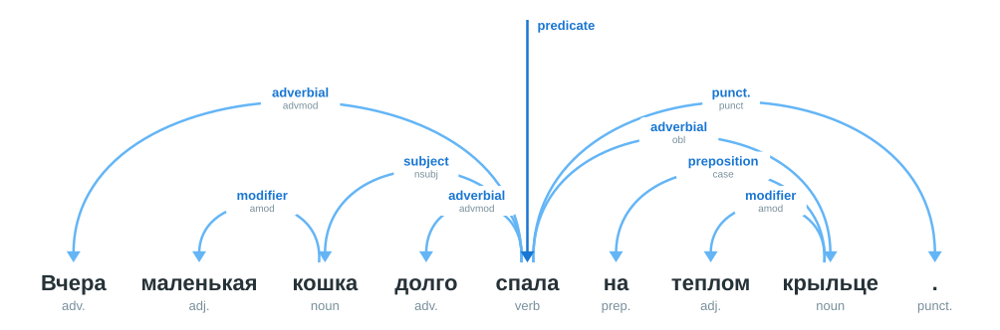

# Parser

``` {.python .signature}
Parser(path=None)
```

A dependency parser: for every word of a sentence it finds the head - the word it depends on - and the [Universal Dependencies](https://universaldependencies.org/u/dep/) relation. The head is the number of a word in the sentence starting from 1; the root of the sentence has 0. Without `path` the package [model](model.md) is used: it is built into the module and loaded once per process (about 10 ms), so a new parser is created instantly. Parsers share a model from a file too: while the file does not change, it is loaded once.

Exceptions:

- `FileNotFoundError` - there is no model file;
- `OSError` - the model file cannot be read: no access, the path points to a directory;
- `ValueError` - the file is not a ruSyntax model, the model has another format version or the file is damaged (the checksum does not match);
- `TypeError` - the path is neither a string nor `os.PathLike`.

=== "Code"

    ``` python
    from rusyntax import Parser

    parser = Parser()
    document = parser.parse_text("Кошка, которую я вчера видел, спала на крыльце.")
    [(word.form, word.head, word.deprel) for word in document.words]
    ```

=== "Result"

    ```
    [('Кошка', 8, 'nsubj'), (',', 6, 'punct'), ('которую', 6, 'obj'), ('я', 6, 'nsubj'), ('вчера', 6, 'advmod'), ('видел', 1, 'acl:relcl'), (',', 1, 'punct'), ('спала', 0, 'root'), ('на', 10, 'case'), ('крыльце', 8, 'obl'), ('.', 8, 'punct')]
    ```

A parse reads well as arcs: each goes from the head to the dependent and is labeled with the relation. The labels in the picture are the school terms for the parts of a sentence, with the UD relation the parser returns under each; the correspondence is approximate: in UD, for example, the prepositional phrase «на теплом крыльце» is `obl`, and the preposition «на» depends on the noun (`case`).



## Parameters

| Parameter | Type | Default | Description |
| :-------- | :--- | :------ | :---------- |
| `path` | `str` / `PathLike` | `None` | A ruSyntax model file; the package model by default |

Read-only properties:

| Property | Type | Description |
| :------- | :--- | :---------- |
| `path` | `Path` / `None` | The absolute path to the model file; `None` for the package model |
| `relations` | `list[str]` | The relations of the model with subtypes: `nsubj`, `obl:tmod`, `root` and others |
| `sources` | `dict` | About the model: the checksum `crc32` (the CRC32 of the model file after its header, which tells one model from another) and how the model was trained - the UD release, the treebanks and their commits, the ruMorph version, LAS on dev |

## Methods

### Parsing a text { #parse_text }

``` {.python .signature}
parse_text(text, *, segmenter=None, analyzer=None)
```

Splits the text into sentences and words with the [anySeg](https://github.com/SergeyShk/anySeg) segmenter, gives the words the lemma, part of speech and features of the [ruMorph](https://github.com/SergeyShk/ruMorph) morphological analyzer in context and finds the head and relation of every word. Returns an anySeg document (`anyseg.Document`) with the columns `lemma`, `upos`, `feats`, `head` and `deprel`: its words, sentences and CoNLL-U output are described in the [anySeg documentation](https://sergeyshk.github.io/anySeg/document/). The default segmenter and analyzer are created on the first call and reused afterwards; your own - a segmenter with your abbreviations or an analyzer with your words, for example - are passed as parameters. The parser does not change the sentence boundaries of anySeg.

| Parameter | Type | Default | Description |
| :-------- | :--- | :------ | :---------- |
| `text` | `str` | | The text |
| `segmenter` | `anyseg.Segmenter` | `None` | A segmenter or an object with the `segment` method; by default `Segmenter("ru")` |
| `analyzer` | `rumorph.Analyzer` | `None` | A morphological analyzer or an object with the `annotate` method; by default `Analyzer()` |

Exceptions: `TypeError` - the text is not a string, the segmenter has no `segment` method or the analyzer has no `annotate` method.

=== "Code"

    ``` python
    document = parser.parse_text("Мы стали друзьями.")
    print(document.to_conllu())
    ```

=== "Result"

    ```
    # newdoc
    # newpar
    # sent_id = 1
    # text = Мы стали друзьями.
    1	Мы	мы	PRON	_	Case=Nom|Number=Plur|Person=1|PronType=Prs	2	nsubj	_	_
    2	стали	стать	VERB	_	Aspect=Perf|Mood=Ind|Number=Plur|Tense=Past|VerbForm=Fin|Voice=Act	0	root	_	_
    3	друзьями	друг	NOUN	_	Animacy=Anim|Case=Ins|Gender=Masc|Number=Plur	2	xcomp	_	SpaceAfter=No
    4	.	.	PUNCT	_	_	2	punct	_	_
    ```

An abbreviation the segmenter does not know splits the sentence; your own segmenter knows it:

=== "Code"

    ``` python
    from anyseg import Segmenter

    segmenter = Segmenter("ru", abbreviations=["прапорщ."])
    document = parser.parse_text("Звонил прапорщ. Петров.", segmenter=segmenter)
    [(word.form, word.head, word.deprel) for word in document.words]
    ```

=== "Result"

    ```
    [('Звонил', 0, 'root'), ('прапорщ.', 1, 'nsubj'), ('Петров', 2, 'flat:name'), ('.', 1, 'punct')]
    ```

### Parsing a document { #annotate }

``` {.python .signature}
annotate(document)
```

Fills the `head` and `deprel` columns of an anySeg document; the previous values are replaced. The parts of speech and features come from the `upos` and `feats` columns, so the document gets its morphology first - usually with `rumorph.Analyzer().annotate(document)`. The document is an `anyseg.Document` or an object with the same interface: `column(name)`, `sentences` (a sentence has `words`, a word has `index`) and `set_columns`. The enhanced graph (the `deps` column) and the empty nodes of a CoNLL-U document are not changed. Parsing runs without the GIL.

Exceptions:

- `ValueError` - a word has no part of speech, a part of speech is not one of the 17 UD parts of speech, or the sentences of the document do not follow each other over all its words;
- `TypeError` - this is not a document (`parse_text` parses a text), the columns of the document are not strings, or a word number is not an integer.

=== "Code"

    ``` python
    from anyseg import Segmenter
    from rumorph import Analyzer

    document = Segmenter("ru").segment("Мама мыла раму.")
    Analyzer().annotate(document)
    parser.annotate(document)
    document.column("head"), document.column("deprel")
    ```

=== "Result"

    ```
    ([2, 0, 2, 2], ['nsubj', 'root', 'obj', 'punct'])
    ```

### Parsing a sentence { #parse }

``` {.python .signature}
parse(words, upos, feats, *, probs=False)
```

The head and relation of every word of the sentence in the same order; an empty sentence gives an empty list. The words come with their part of speech and features in the UD annotation - as ruMorph gives them. The part of speech is one of the 17 UD parts of speech in capitals (`NOUN`, `VERB`, `X`): with other tags, lowercase or OpenCorpora ones for example, the model would parse almost at random, so they are an error. The features are a CoNLL-U field (`Case=Nom|Number=Sing`) or a dictionary, like `feats` of a ruMorph analysis; `_`, an empty string, an empty dictionary or `None` mean no features. Features unknown to the model are skipped. Parsing runs without the GIL.

| Parameter | Type | Description |
| :-------- | :--- | :---------- |
| `words` | `Iterable[str]` | The word forms |
| `upos` | `Iterable[str]` | The UD parts of speech |
| `feats` | `Iterable[str \| Mapping[str, str] \| None]` | The UD features of every word |
| `probs` | `bool` | Add the [probabilities](#probs) of the head and the relation: quadruples instead of pairs |

Exceptions:

- `ValueError` - the lengths of `words`, `upos` and `feats` differ, or a part of speech is not one of the 17 UD parts of speech;
- `TypeError` - the input is not a collection of strings (a string instead of a list is an error too).

=== "Code"

    ``` python
    parser.parse(
        ["Я", "читаю", "книгу"],
        ["PRON", "VERB", "NOUN"],
        ["Case=Nom|Number=Sing|Person=1", "Aspect=Imp|Tense=Pres", "Case=Acc|Number=Sing"],
    )
    ```

=== "Result"

    ```
    [(2, 'nsubj'), (0, 'root'), (2, 'obj')]
    ```

If the text is already split into words, ruMorph gives them the morphology in context: the first analysis of every word is the one its context model picked.

=== "Code"

    ``` python
    from rumorph import Analyzer

    words = ["Кошка", "спала", "на", "крыльце", "."]
    best = [analyses[0] for analyses in Analyzer().analyze_sentence(words)]
    parser.parse(words, [a.pos for a in best], [a.feats for a in best])
    ```

=== "Result"

    ```
    [(2, 'nsubj'), (0, 'root'), (4, 'case'), (2, 'obl'), (2, 'punct')]
    ```

### Parsing many sentences { #parse_many }

``` {.python .signature}
parse_many(sentences, *, probs=False)
```

The same as `parse` for every sentence, but faster: sentences of close lengths are parsed four at a time. A sentence is a triple (forms, parts of speech, features); `probs=True` adds the [probabilities](#probs), as in `parse`. Parsing runs without the GIL in chunks of 256 sentences; Ctrl+C works between them.

Exceptions: `ValueError` - a sentence is not three collections, their lengths differ, or a part of speech is not one of the 17 UD parts of speech; `TypeError` - the input is not a collection of strings.

=== "Code"

    ``` python
    parser.parse_many(
        [
            (["Привет", "!"], ["INTJ", "PUNCT"], [None, None]),
            (["Идет", "дождь"], ["VERB", "NOUN"], ["_", "Case=Nom"]),
        ]
    )
    ```

=== "Result"

    ```
    [[(0, 'root'), (1, 'punct')], [(0, 'root'), (1, 'nsubj')]]
    ```

## Probabilities { #probs }

With `probs=True` every word has, besides its head and relation, two probabilities from the model: `head_prob` of the head among all the words of the sentence and the root (among the candidates of the [window](#tree) in a sentence longer than 1024 words), and `deprel_prob` of the relation given this head; the `root` relation of the root and the `vocative` relation of a mention `@name` at the start of a sentence are set by the [rule](#tree), and their probability is 1. Their product is the probability that the relation is right as a whole. The probabilities tell reliable relations from doubtful ones: on dev Taiga, GSD and SynTagRus the head is right for 97-99 % of the words with `head_prob` from 0.99 (52-68 % of the words), and for about 40 % below 0.5 (3-8 % of the words). The probabilities are local - per word, not per tree - and slightly high: the mean `head_prob` is 2-5 points above the share of right heads.

=== "Code"

    ``` python
    words = ["Я", "видел", "девочку", "с", "биноклем", "."]
    best = [analyses[0] for analyses in Analyzer().analyze_sentence(words)]
    relations = parser.parse(words, [a.pos for a in best], [a.feats for a in best], probs=True)
    [
        (word, head, deprel, round(p, 2), round(q, 2))
        for word, (head, deprel, p, q) in zip(words, relations)
    ]
    ```

=== "Result"

    ```
    [('Я', 2, 'nsubj', 1.0, 1.0), ('видел', 0, 'root', 1.0, 1.0), ('девочку', 2, 'obj', 1.0, 1.0), ('с', 5, 'case', 1.0, 1.0), ('биноклем', 2, 'obl', 0.57, 1.0), ('.', 2, 'punct', 1.0, 1.0)]
    ```

## The parse tree { #tree }

Every word has one head, a sentence has one root, and there are no cycles; non-projective trees (crossing relations) are allowed. The parser picks the tree with the highest sum of head scores (the Chu - Liu - Edmonds algorithm). For degenerate sentences, where the best heads give more than 16 cycles or 8 root candidates, the tree is built faster: the extra roots and the nodes of cycles are attached to the best root. The tree of a sentence longer than 1024 words is built the same way - text without punctuation, for example, which the segmenter does not split into sentences; the head of a word in it is looked for among 64 words on each side and the root, so the parsing time grows linearly with the length. The relations come with subtypes, as in the UD annotation (`nsubj:pass`, `obl:tmod`); only the root has the `root` relation; the CoNLL 2018 evaluation compares the relation without the subtype. A mention `@name` at the start of a sentence, unless it is the root, is an address to the root of the sentence (`vocative`), as UD annotates it: the training treebanks have few such mentions, and the model hardly recognizes them by itself.

## Threads and processes { #threads }

The parser does not change while parsing: one parser can be shared between threads, and parsing runs without the GIL, so the threads parse in parallel. On Python 3.14t and 3.15t without the GIL the module does not enable the GIL. The parser moves to another process with pickle: the absolute path to the model, or the mark of the package model, is saved. `copy.copy` and `copy.deepcopy` return the same object. Parsers are equal if their model comes from the same file or both use the package model; a parser can be held by a weak reference (`weakref`).
