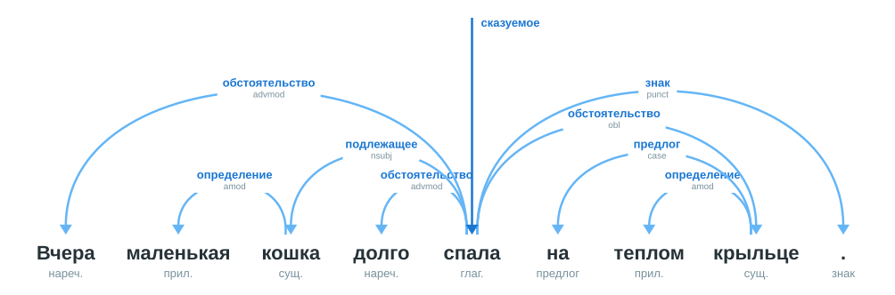

# Анализатор

``` {.python .signature}
Parser(path=None)
```

Синтаксический анализатор: для каждого слова предложения находит вершину - слово, от которого оно зависит, - и тип связи [Universal Dependencies](https://universaldependencies.org/u/dep/). Вершина - номер слова в предложении с 1, у корня предложения - 0. Без `path` используется [модель](model.md) из пакета: она вшита в модуль и загружается один раз на процесс (около 10 мс), поэтому новый анализатор создается мгновенно. Модель из файла анализаторы тоже делят: пока файл не изменился, она загружается один раз.

Исключения:

- `FileNotFoundError` - нет файла модели;
- `OSError` - файл модели не читается: нет доступа, путь указывает на каталог;
- `ValueError` - файл не модель ruSyntax, модель другой версии формата или файл поврежден (не совпадает контрольная сумма);
- `TypeError` - путь не строка и не `os.PathLike`.

=== "Код"

    ``` python
    from rusyntax import Parser

    parser = Parser()
    document = parser.parse_text("Кошка, которую я вчера видел, спала на крыльце.")
    [(word.form, word.head, word.deprel) for word in document.words]
    ```

=== "Результат"

    ```
    [('Кошка', 8, 'nsubj'), (',', 6, 'punct'), ('которую', 6, 'obj'), ('я', 6, 'nsubj'), ('вчера', 6, 'advmod'), ('видел', 1, 'acl:relcl'), (',', 1, 'punct'), ('спала', 0, 'root'), ('на', 10, 'case'), ('крыльце', 8, 'obl'), ('.', 8, 'punct')]
    ```

Разбор удобно читать как дуги: каждая идет от главного слова к зависимому, подпись - тип связи. Названия на картинке - школьные члены предложения, под ними - тип связи UD, который возвращает анализатор; соответствие приблизительное: в UD, например, предложная группа «на теплом крыльце» - `obl`, а предлог «на» зависит от существительного (`case`).



## Параметры

| Параметр | Тип | По умолчанию | Описание |
| :------- | :-- | :----------- | :------- |
| `path` | `str` / `PathLike` | `None` | Файл модели ruSyntax; по умолчанию - модель пакета |

Свойства, только для чтения:

| Свойство | Тип | Описание |
| :------- | :-- | :------- |
| `path` | `Path` / `None` | Абсолютный путь к файлу модели; `None` - модель пакета |
| `relations` | `list[str]` | Типы связей модели с подтипами: `nsubj`, `obl:tmod`, `root` и другие |
| `sources` | `dict` / `None` | Описание обучения модели: релиз UD, трибанки и их коммиты, версия ruMorph, LAS на dev |

## Методы

### Разбор текста { #parse_text }

``` {.python .signature}
parse_text(text)
```

Делит текст на предложения и слова сегментатором [anySeg](https://github.com/SergeyShk/anySeg), ставит словам лемму, часть речи и признаки морфологическим анализатором [ruMorph](https://github.com/SergeyShk/ruMorph) с контекстом и находит вершину и связь каждого слова. Возвращает документ anySeg (`anyseg.Document`) со столбцами `lemma`, `upos`, `feats`, `head` и `deprel`: его слова, предложения и запись в CoNLL-U описаны в [документации anySeg](https://sergeyshk.github.io/anySeg/document/). Сегментатор и анализатор создаются при первом вызове и дальше переиспользуются. Границы предложений anySeg анализатор не меняет.

Исключения: `TypeError` - текст не строка.

=== "Код"

    ``` python
    document = parser.parse_text("Мы стали друзьями.")
    print(document.to_conllu())
    ```

=== "Результат"

    ```
    # newdoc
    # newpar
    # sent_id = 1
    # text = Мы стали друзьями.
    1	Мы	мы	PRON	_	Case=Nom|Number=Plur|Person=1|PronType=Prs	2	nsubj	_	_
    2	стали	стать	VERB	_	Aspect=Perf|Mood=Ind|Number=Plur|Tense=Past|VerbForm=Fin|Voice=Act	0	root	_	_
    3	друзьями	друг	NOUN	_	Animacy=Anim|Case=Ins|Gender=Masc|Number=Plur	2	xcomp	_	SpaceAfter=No
    4	.	.	PUNCT	_	_	2	punct	_	_
    ```

### Разбор документа { #annotate }

``` {.python .signature}
annotate(document)
```

Заполняет столбцы `head` и `deprel` документа anySeg; прежние значения заменяются. Части речи и признаки берутся из столбцов `upos` и `feats`, поэтому документ сначала разбирают морфологически - обычно `rumorph.Analyzer().annotate(document)`. Документ - `anyseg.Document` или объект с тем же устройством: `column(name)`, `sentences` (у предложения - `words`, у слова - `index`) и `set_columns`. Расширенный граф (столбец `deps`) и пустые узлы документа CoNLL-U не меняются. Разбор идет без GIL.

Исключения:

- `ValueError` - у слова нет части речи, часть речи не из 17 частей речи UD или предложения документа не идут подряд по всем его словам;
- `TypeError` - это не документ (текст разбирает `parse_text`), столбцы документа не строки или номер слова не целое число.

=== "Код"

    ``` python
    from anyseg import Segmenter
    from rumorph import Analyzer

    document = Segmenter("ru").segment("Мама мыла раму.")
    Analyzer().annotate(document)
    parser.annotate(document)
    document.column("head"), document.column("deprel")
    ```

=== "Результат"

    ```
    ([2, 0, 2, 2], ['nsubj', 'root', 'obj', 'punct'])
    ```

### Разбор предложения { #parse }

``` {.python .signature}
parse(words, upos, feats)
```

Вершина и связь каждого слова предложения в том же порядке; у пустого предложения - пустой список. Слова приходят уже с частью речи и признаками в разметке UD - как их ставит ruMorph. Часть речи - одна из 17 частей речи UD заглавными буквами (`NOUN`, `VERB`, `X`): с другими тегами, например строчными или OpenCorpora, модель разбирала бы почти наугад, поэтому они - ошибка. Признаки - запись CoNLL-U (`Case=Nom|Number=Sing`) или словарь, как `feats` у разбора ruMorph; `_`, пустая строка, пустой словарь или `None` - без признаков. Незнакомые модели признаки пропускаются. Разбор идет без GIL.

| Параметр | Тип | Описание |
| :------- | :-- | :------- |
| `words` | `Iterable[str]` | Формы слов |
| `upos` | `Iterable[str]` | Части речи UD |
| `feats` | `Iterable[str \| Mapping[str, str] \| None]` | Признаки UD каждого слова |

Исключения:

- `ValueError` - длины `words`, `upos` и `feats` не совпадают или часть речи не из 17 частей речи UD;
- `TypeError` - вход не набор строк (строка вместо списка тоже ошибка).

=== "Код"

    ``` python
    parser.parse(
        ["Я", "читаю", "книгу"],
        ["PRON", "VERB", "NOUN"],
        ["Case=Nom|Number=Sing|Person=1", "Aspect=Imp|Tense=Pres", "Case=Acc|Number=Sing"],
    )
    ```

=== "Результат"

    ```
    [(2, 'nsubj'), (0, 'root'), (2, 'obj')]
    ```

Если текст уже поделен на слова, морфологию им ставит ruMorph с контекстом: первым у каждого слова идет разбор, который выбрала его контекстная модель.

=== "Код"

    ``` python
    from rumorph import Analyzer

    words = ["Кошка", "спала", "на", "крыльце", "."]
    best = [analyses[0] for analyses in Analyzer().analyze_sentence(words)]
    parser.parse(words, [a.pos for a in best], [a.feats for a in best])
    ```

=== "Результат"

    ```
    [(2, 'nsubj'), (0, 'root'), (4, 'case'), (2, 'obl'), (2, 'punct')]
    ```

### Разбор многих предложений { #parse_many }

``` {.python .signature}
parse_many(sentences)
```

То же, что `parse` для каждого предложения, но быстрее: предложения близкой длины разбираются по четыре сразу. Предложение - тройка (формы, части речи, признаки). Разбор идет без GIL кусками по 256 предложений, между ними срабатывает Ctrl+C.

Исключения: `ValueError` - у предложения не три набора, их длины не совпадают или часть речи не из 17 частей речи UD; `TypeError` - вход не набор строк.

=== "Код"

    ``` python
    parser.parse_many(
        [
            (["Привет", "!"], ["INTJ", "PUNCT"], [None, None]),
            (["Идет", "дождь"], ["VERB", "NOUN"], ["_", "Case=Nom"]),
        ]
    )
    ```

=== "Результат"

    ```
    [[(0, 'root'), (1, 'punct')], [(0, 'root'), (1, 'nsubj')]]
    ```

## Дерево разбора { #tree }

У каждого слова одна вершина, корень в предложении один, циклов нет; непроективные деревья (связи, которые пересекаются) допустимы. Анализатор выбирает дерево с наибольшей суммой оценок вершин (алгоритм Чу - Лю - Эдмондса). У вырожденных предложений, где лучшие вершины дают больше 16 циклов или 8 кандидатов в корень, дерево собирается быстрее: лишние корни и узлы циклов подвешиваются к лучшему корню. Так же собирается дерево предложений длиннее 1024 слов - например, текста без знаков препинания, который сегментатор не делит на предложения; вершина слова в нем ищется среди 64 слов с каждой стороны и корня, поэтому время разбора растет с длиной линейно. Типы связей - с подтипами, как в разметке UD (`nsubj:pass`, `obl:tmod`); связь `root` - только у корня; оценка CoNLL 2018 сравнивает тип без подтипа.

## Потоки и процессы { #threads }

Анализатор не меняется при разборе: один анализатор можно разделять между потоками, а разбор идет без GIL, поэтому потоки разбирают параллельно. На Python 3.14t и 3.15t без GIL модуль GIL не включает. Анализатор переносится в другой процесс через pickle: сохраняется абсолютный путь к модели или признак модели пакета. `copy.copy` и `copy.deepcopy` возвращают тот же объект. Анализаторы равны, если модель у них из одного файла или обе - модель пакета; на анализатор можно держать слабую ссылку (`weakref`).
